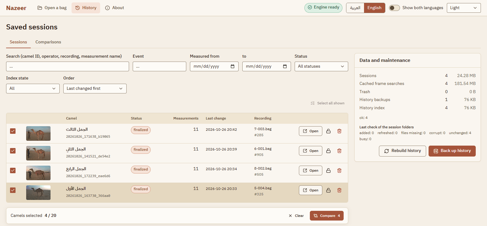
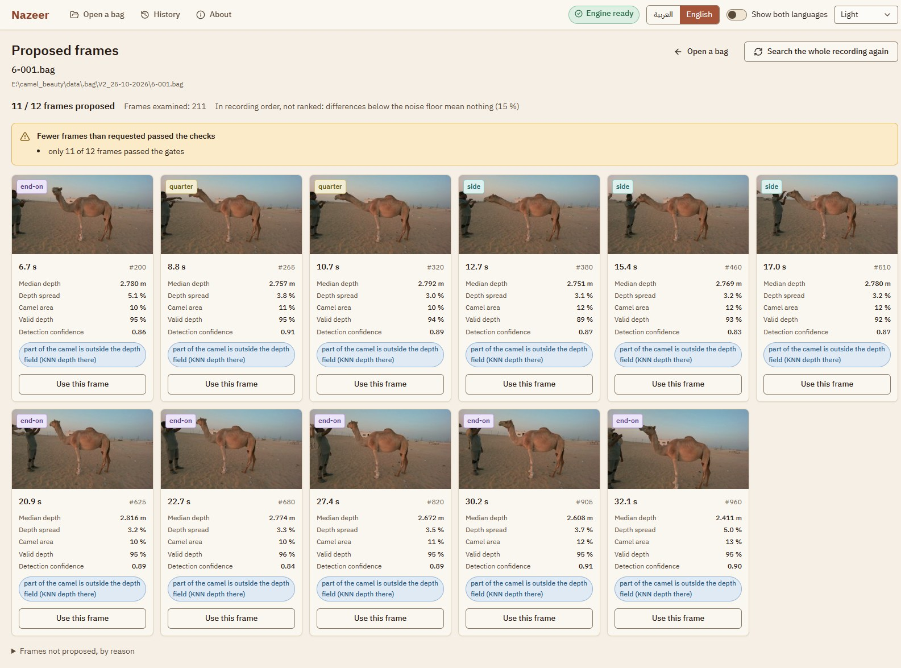
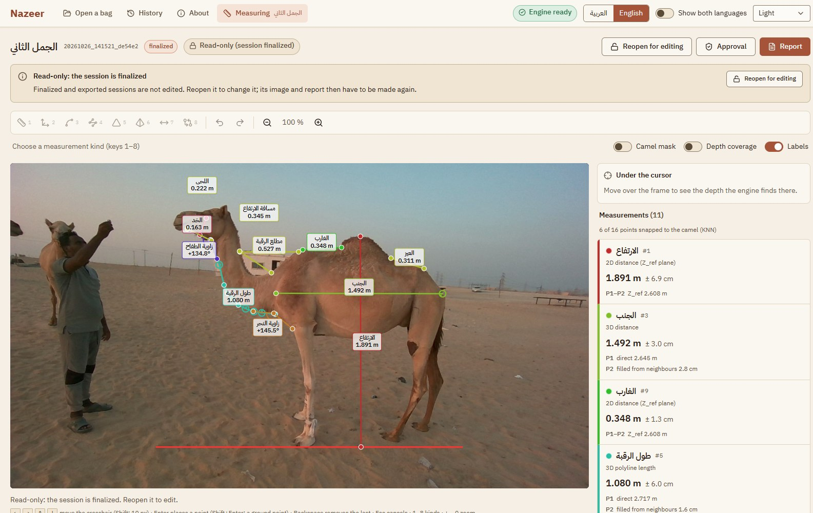
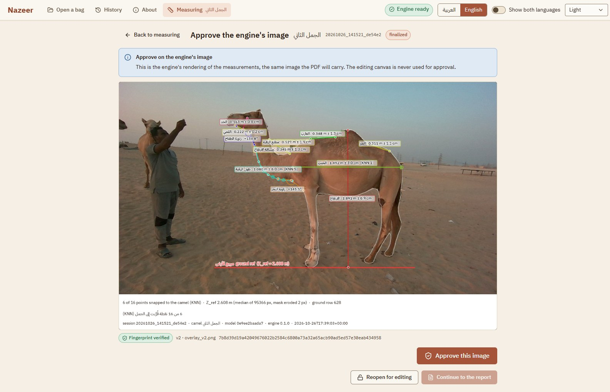
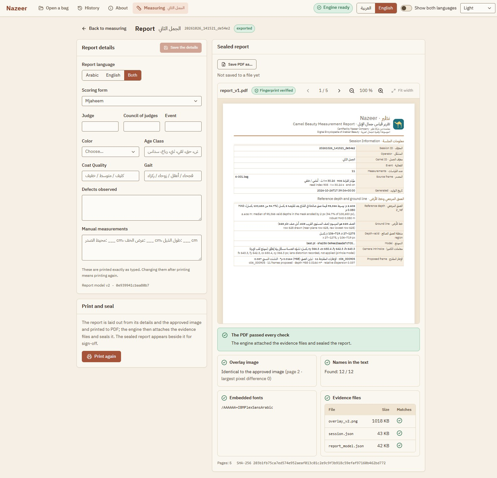
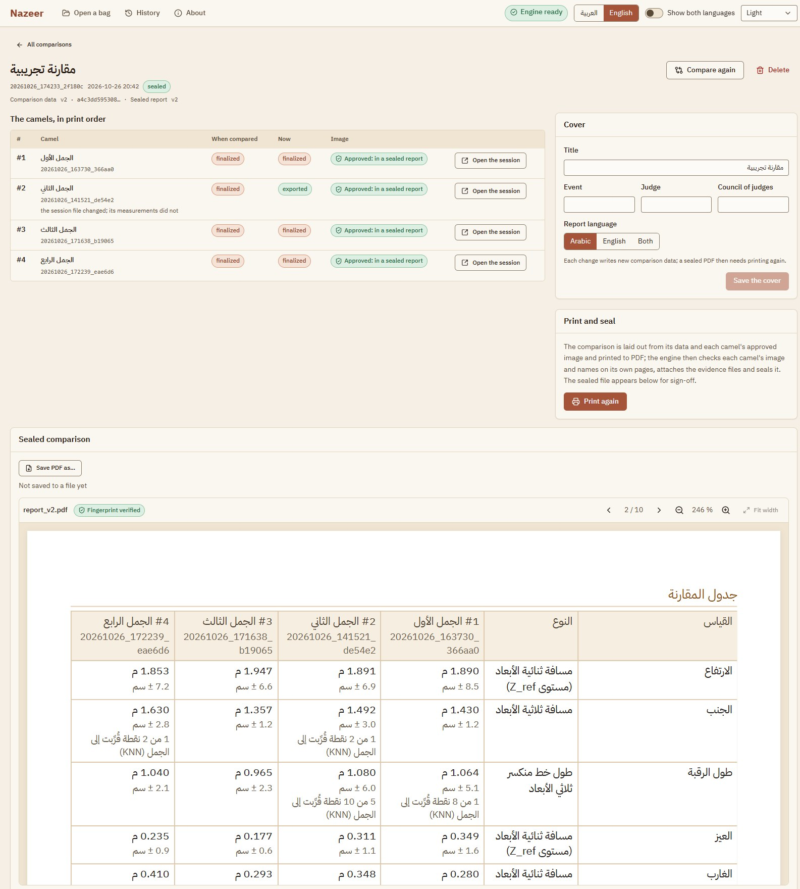
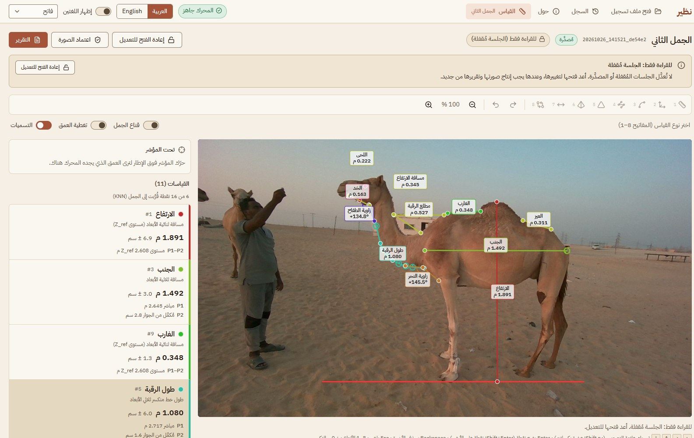

# Nazeer Desktop (نظير)

Non-contact camel body measurement for Mzayen camel-beauty judging. Nazeer Desktop is a
Windows desktop app. It reads an Intel RealSense D455 recording (`.bag`), proposes the best
frames of the camel, and lets the judge measure on the chosen frame. It then produces a sealed,
bilingual Arabic/English PDF report, for one camel or for up to 20 camels compared side by side.

It runs fully offline. There is no cloud service, no CDN, no font download and no package
installation at runtime.

The app measures what the judge draws. It never scores beauty, ranks camels or picks a winner.

> **Version 1.1.0** (2026-10-18). Status: **integration-tested**. The whole flow, comparisons
> included, runs on real recordings with the real model (`NAZEER_REAL=1 npm run e2e`: 33 passed).
> On the development laptop the packaged installer passed its install-and-run check (24/24) and
> an in-place upgrade from 1.0.0. **Not production-validated**: the installer is unsigned, and the
> app has not yet been run on the field laptop or validated on a field capture.

## What is new in 1.1.0

- **Save PDF as…** Every sealed report can be saved anywhere, under any name. The Save dialog
  opens by itself after each seal. The same button is on the Report screen, on History rows and
  on comparisons. The app's own sealed copy stays where it is.
- **Comparison report.** Pick 1 to 20 finalized camels in History and put them in order. One
  sealed PDF then shows them side by side: a cover, a comparison table and one section per camel.
  Comparisons are listed in **History → Comparisons**.
- **History** gains filters for the event and the measuring date.
- History's index moves to version 2 by itself at the first start. Sessions from 1.0.0 are kept.

## What the operator does

1. **Open a recording.** Pick a D455 `.bag` file with the file dialog, from the recent list,
   or from a scan of the capture folders. The recording must hold both the colour (RGB) stream
   and the depth stream. The camel is found in the colour image, so a depth-only recording is
   refused ("The bag file cannot be read").
2. **Choose a frame.** The engine walks the recording and finds the camel in each sampled frame
   (YOLO11n segmentation). It proposes up to 12 frames, the ones whose depth is most even over the
   camel's body. They are shown in recording order, not ranked. The operator picks one.
3. **Measure.** The operator names each measurement and draws it on the frame, with the
   mouse or with a keyboard crosshair. There are eight kinds:

   | Kind | How it is computed |
   |---|---|
   | 2D distance | in the camel's reference plane (Z_ref, the median depth of the camel) |
   | 3D distance | from the depth at each end point |
   | 2D curve | a polyline in the reference plane |
   | 3D curve | a polyline through the depth at each control point |
   | Angles (4 kinds) | 3 points in 2D, 3 points in 3D, from the horizontal, or between two lines |

   The operator always picks the kind; nothing falls back from 3D to 2D. Each value carries an
   uncertainty (±). When a point has no direct depth, the app takes it from the nearest points on
   the camel's body (KNN), shows that on screen and prints it in the report. A value that cannot
   be measured is rejected with a reason; it is never replaced by a guess.
4. **Save and come back.** Every change is saved automatically. Each session appears in
   **History**, where it can be searched, reopened, continued, inspected or deleted.
5. **Report.** The engine draws the final measurement image once, and the operator approves that
   image. The app then prints the report to PDF in Arabic, English or both. The engine attaches
   the image and the session data to the PDF, checks the PDF's pixels, text and fonts, and seals
   it. The operator signs off on the PDF inside the app. The Save dialog then offers to save a copy
   anywhere. The app checks that the copy is identical to the sealed PDF and refuses to save it
   inside its own data folder.
6. **Compare.** In History, tick the finalized camels (up to 20) and choose **Compare**.
   - Set their order and the cover: title, event, judge, council and report language.
   - A camel that has no report sealed from its current image is approved in the same dialog, on
     its full engine image.
   - The sealed comparison holds a cover, one table with the camels side by side, and one section
     per camel with its approved image and measurements, followed by signature boxes.
   - Nothing is ranked, sorted by value, totalled or highlighted; the camels appear in the
     operator's order.
   - Reopening, editing, re-finalizing or deleting a camel marks the comparison **out of date**,
     with the reason. Its sealed PDF stays viewable and can still be saved. **Compare again**
     makes a new comparison.

## Screenshots

These were taken on 2026-11-08 from version 1.1.0. They show a copy of four camels the operator
measured on 2026-10-26.

**History.** Every saved session can be searched and filtered. Tick up to 20 finalized camels to
compare them.



**Proposed frames.** The engine walked the recording and proposes its best frames, in recording
order and not ranked, with each frame's depth figures.



**Measuring.** Each named measurement is drawn on the frame. It shows its value, its uncertainty
(±), and where each point's depth came from: measured directly, or taken from nearby points on the
camel (KNN). This session is finalized, so the screen is read-only.



**Approval.** This is the engine's own image of the measurements, checked by its SHA-256
fingerprint. The judge approves this image, never the editing view.



**Report.** The sealed PDF is shown inside the app. The engine checked its image pixels, the names
in its text, its font and its attached evidence files. "Save PDF as…" saves a copy anywhere.



**Comparison.** Several camels appear side by side in one sealed PDF, in the operator's order,
with no ranking.



**Arabic.** The whole interface also works right to left, in Arabic.



## Installing (for operators)

- **Requires:** Windows 11, 64-bit (tested); Windows 10 has not been tested. Windows "N" editions
  need the Media Feature Pack.
  - Size: the installer is about 334 MB, and the installed program takes about 1.6 GB.
  - `%TEMP%` needs about 2.6 GB free while it installs. Installing takes about 3 minutes.
- **Smart App Control (important).** The installer is **not code-signed yet**. Check it in Windows
  Security → App & browser control → Smart App Control before installing:
  - **On:** Windows refuses the installer ("An Application Control policy has blocked this
    file").
  - **Evaluation or Off:** the installer runs. SmartScreen shows an "unrecognized app" warning
    (More info, then Run anyway).
  - Turning Smart App Control off cannot be undone without resetting Windows, so it is the PC
    owner's decision. The lasting fix is a code-signing certificate.
- **Install:** run `Nazeer Desktop Setup 1.1.0.exe`. The installer works in Arabic or English.
  It installs for the current user by default, or for all users.
- **Upgrade from 1.0.0:** install 1.1.0 over it. Sessions, History and the licence are kept, and
  History's index moves to version 2 by itself at the first start.
- **Activate:** on first start the app asks for a licence key. It is checked on the computer
  itself, with no internet.
  - A trial key stops working on its expiry date; a permanent key never asks again.
  - A key can be replaced later from the **About** screen (Change key).
- **Where the data lives:** `%APPDATA%\Nazeer Desktop\`. Uninstalling keeps this folder.
  - **Sessions:** each is a folder under `sessions\<session id>\` (the id starts with the UTC date
    and time). It holds the frame, `session.json`, the approved image and the reports
    `report_v1.pdf`, `report_v2.pdf`, …
  - **Comparisons:** each is a folder under `comparisons\<comparison id>\`, with its comparison
    data and its sealed PDFs.
  - **Refused prints:** a file named `report_vN.rejected_….pdf` is a print the engine refused.
  - **Copying PDFs:** copy them unchanged, or use **Save PDF as…**. They carry their evidence
    files as attachments, and the manifest records their SHA-256.

## How it is built

```
.bag ─► engine: read the recording, find the camel, propose frames ─► app: the operator picks a frame
     ─► engine: reference depth, ground line, depth for every point (direct, else KNN)
     ─► app: the operator draws named measurements (an editing view, never the approval surface)
     ─► engine: computes every value, saves the session, draws the measurement image once
     ─► app: approve on that image ─► print page ─► Electron printToPDF
     ─► engine: attaches the image and the session to the PDF, checks it, writes the manifest
     ─► bilingual PDF, reviewed in the app before signing ─► Save PDF as… (a verified copy)

History ─► app: 1–20 finalized camels, in the operator's order, each image approved
        ─► engine: the comparison data (texts only: no ranking, no totals)
        ─► app: print page ─► Electron printToPDF
        ─► engine: checks each camel's image and names on its own pages, attaches every camel's
           evidence, seals the comparison
```

| Part | Technology | Role |
|---|---|---|
| `app/` | Electron 44, electron-vite 5 (Vite 7), React 19, Redux Toolkit, Tailwind CSS v4, TypeScript 5.9 | The operator UI, the engine's supervisor, licence keys, printing to PDF, saving copies, the installer |
| `engine/` | Python 3.11, FastAPI, pyrealsense2, Ultralytics YOLO (CPU), NumPy/SciPy, matplotlib, pypdf | Reading recordings, segmentation, depth, the measurement maths, sessions, History and comparisons, the measurement image, sealing the PDFs |
| `engine/models/` | one pinned checkpoint, `best.pt` | checked against its SHA-256 at every start (see `MODEL_CARD.md`) |

The app starts the engine as a local process on `127.0.0.1`, with a fresh token at each start, and
talks to it over HTTP.
- **API:** the engine's 39 operations are described in `engine/openapi.json`, and the app's client
  types are generated from it.
- **Versions:** the engine's own version (0.1.0) is stamped in every session and report, next to the
  app's version, the model's SHA-256 and the library versions.
- **Font:** the report font is IBM Plex Sans Arabic, bundled with the app.

## Repository layout

| Path | What is there |
|---|---|
| `app/` | the Electron app (`src/main`, `src/preload`, `src/renderer`, `src/print`, `src/shared`), its tests, the end-to-end specs (`e2e/`), build scripts (`scripts/`) and installer resources (`build/`) |
| `engine/` | the Python engine (`nazeer_engine/`), its tests, `openapi.json`, `tools/real_run.py` (the real-recording check) and `tools/measure_comparison_seal.py` (comparison size and timing) |
| `tools/generate-license.mjs` | the licence-key generator (vendor machine only, never packaged) |
| `docs/decisions/` | decision records D1–D12 (start with `README.md`) |
| `docs/arabic-wording-backlog.md` | the app's Arabic wording, its reviews and open suggestions |
| `docs/reuse-map.md` | what was taken from the parent repository, and how to take more |
| `docs/screenshots/` | the screenshots shown in this README |
| `fixtures/golden_frame.json` | the reference frame used to test the engine against a real recording |
| `CLAUDE.md` | the full developer guide: contracts, commands, architecture, pitfalls |

Not in git:
- the recordings (`data/`);
- the model weights (`engine/models/*.pt`);
- the Python environment (`engine/.venv/`) and `app/node_modules/`;
- build output (`app/out/`, `app/dist-engine/`, `app/release/`);
- run data (`runs/`).

## Development

Requirements: Windows, Node 24 (≥ 24.15) with npm 11, Python 3.11 (`py -3.11`), and the
model file `engine/models/best.pt`.

```powershell
# Engine: create the environment once (needs the network once; CPU-only PyTorch)
py -3.11 -m venv engine\.venv
engine\.venv\Scripts\python.exe -m pip install --extra-index-url https://download.pytorch.org/whl/cpu -r engine\requirements.txt -r engine\requirements-dev.txt

# App
cd app
npm install          # exact pinned versions; also fetches the checksum-pinned Electron binary
npm run dev          # the app with hot reload, plus its engine on ..\runs\dev_root
```

Always call the engine's Python as `engine\.venv\Scripts\python.exe`; a bare `python` may be a
different version.

### Checks

Test counts are those of release 1.1.0 (2026-10-18).

```powershell
# Engine (from engine\)
.venv\Scripts\python.exe -m pytest -q                       # 502 tests, about a minute
.venv\Scripts\python.exe -m ruff check . ; .venv\Scripts\python.exe -m ruff format --check .
.venv\Scripts\python.exe tools\real_run.py                  # the whole flow on a real recording

# App (from app\)
npm run typecheck ; npm run lint ; npm run format:check
npm test                                                    # Vitest unit and component tests (863)
npm run e2e                                                 # Playwright on the built app
$env:NAZEER_REAL = "1"; npm run e2e                         # adds the real-recording flows (33 passed)
```

`NAZEER_REAL=1` runs the full flow and the comparison flow on a real recording with the real model.
After any change to the engine's API, regenerate `engine/openapi.json`
(`python -m nazeer_engine --dump-openapi openapi.json`) and the app's types (`npm run gen:api`);
tests fail when either drifts.

### Building the installer

```powershell
cd app
npm run dist                                    # release\Nazeer Desktop Setup <version>.exe
npm run smoke:packaged -- --move-profile-aside  # install, activate, run, relaunch, uninstall
npm run check:sandbox                           # the clean-PC checklist in Windows Sandbox
```

`npm run dist` builds the app and stages the engine (`npm run stage:engine`): an embedded CPython
3.11 with its runtime packages and the model. It then packages an NSIS installer with
electron-builder. The installer is unsigned.

Since 2026-10-18 the Windows Sandbox on the development laptop enforces Smart App Control. It
refuses the unsigned installer (1.0.0 included), so `npm run check:sandbox` cannot pass until the
installer is signed. It passed every item for 1.0.0 on 2026-10-14.

### Licence keys

Keys are Ed25519-signed and verified offline (decision D11). The generator runs on the
vendor's machine only:

```powershell
node tools/generate-license.mjs --init                  # once: create the key pair, write the app's public key
node tools/generate-license.mjs --days 7                # a 7-day trial key
node tools/generate-license.mjs --customer "Name"       # a permanent key
```

The private key lives in `%USERPROFILE%\.nazeer-license\` and should be backed up. It must never
enter a repository; the generator refuses repository folders. Losing it means a new key pair, a
rebuild, and new keys for every client.

## Engineering rules

- **Honest values.** A rejected measurement is empty with a reason, never a degraded number.
  Every depth fallback is recorded and shown to the judge.
- **One rendering authority.** The engine draws the measurement image. The judge approves that
  image and signs off on the PDF, never on the live editing canvas.
- **No ranking.** Comparisons show camels side by side in the operator's order. Nothing is sorted
  by value, totalled, subtracted or highlighted.
- **Offline.** Nothing is fetched at runtime.
- **Status words.** Work is described as code state, unit-tested, integration-tested (real
  recording, real model) or production-validated.

Decisions are recorded in `docs/decisions/` before code is written against them.

## Open items

- **Code signing.** Until the installer is signed, a PC with Smart App Control on refuses it, and
  the Sandbox check cannot run.
- **Field check.** It needs the field laptop and new D455 captures that hold both the colour and
  depth streams. The two recordings of 2026-10-20 (`data/.bag/new/`) hold depth only and cannot be
  used. The model was trained on 191 photos of one camel, none taken with the D455.
- **Model licence** (Ultralytics, AGPL-3.0; decision D6). It is still open. Two client deliveries
  were made under the operator's responsibility: 1.0.0 with a 7-day trial key (2026-10-14) and
  1.1.0 with a permanent key (2026-10-18).
- **Report questions** (D7, also for comparisons): signatures, one PDF per language, PDF/A, the
  scoring-form heading.
- **Comparison settings awaiting confirmation** (D12), among them the 20-camel limit.
- **Frame-completeness rule** (D10, C2.4): revised on real recordings, awaiting confirmation.

## Licences

This repository is private; no licence is granted. Third-party components include Ultralytics
YOLO (AGPL-3.0), python-bidi (LGPL), IBM Plex Sans Arabic (SIL OFL 1.1), Electron and the npm
and Python packages pinned in `app/package-lock.json` and `engine/requirements.txt`.
